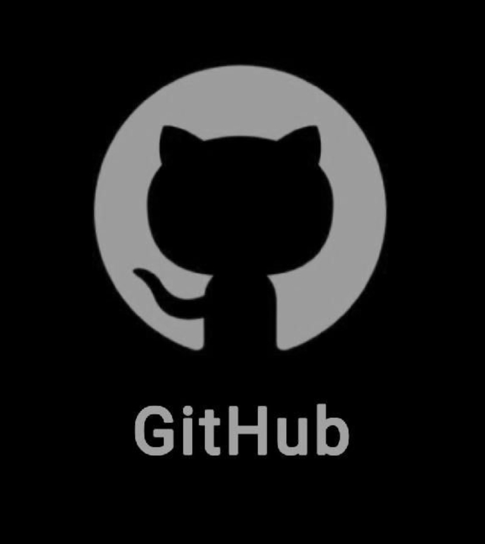

 

---

## 👨‍💻 About Me

Hey! I'm **Melroy Luvis Almeida**, a Computer Science Engineering student passionate about technology, innovation, and building things that make a difference.

I enjoy turning creative ideas into functional products and exploring technologies across different domains.

- 🎓 Computer Science Engineering Student
- 💻 Passionate about Software Development
- 🤖 Exploring Artificial Intelligence & Machine Learning
- 🌐 Interested in Full-Stack and Mobile Development
- 🔌 Experimenting with IoT and Automation
- ☁️ Exploring Cloud Technologies and Backend Systems
- 🏆 Participating in Hackathons and Tech Communities
- 🤝 Always open to collaboration and new ideas

 

### ⚡ My Philosophy

**Never stop experimenting. Every failure is just another version of progress.**

---

## 🚀 What I'm Exploring

| Domain | Interests |
|:---:|:---|
| 🌐 Web Development | Full-Stack Applications, APIs, Backend Systems |
| 🤖 AI & ML | Machine Learning, Computer Vision, Generative AI |
| 📱 App Development | Mobile Applications, Flutter |
| 🔌 IoT | ESP32, Smart Systems, Automation |
| ☁️ Cloud | Deployment, Cloud Infrastructure, Firebase |
| ⚙️ Software Engineering | DSA, System Design, Production-Level Projects |

---

## 🛠️ Tech Stack & Tools

### 💻 Programming Languages

### 🌐 Frontend Development

### ⚙️ Backend & Mobile Development

### 🗄️ Databases & Backend Services

### 🤖 AI, ML & Data Science

### ☁️ Cloud, Deployment & Developer Tools

### 🎨 Design & Creative Tools

---

## 📊 GitHub Analytics

  

---

## 🏆 My GitHub Achievements

<table>
<tr>
<td align="center" width="50%">

### 🦈 Pull Shark

*Merged Pull Requests*

</td>
<td align="center" width="50%">

### 🌈 YOLO

*Merged a Pull Request without review*

</td>
</tr>
</table>

**More milestones. More contributions. More achievements to unlock! 🚀**

---

## 💬 Developer Quote

---

## 🤝 Let's Connect!

I'm always excited to meet developers, exchange ideas, collaborate on interesting projects, and explore new technologies.

**Got an interesting idea? Let's make it happen!**

 

  

### ✨ Thanks for visiting my profile!

**Keep Creating. Keep Innovating. Keep Building.**

