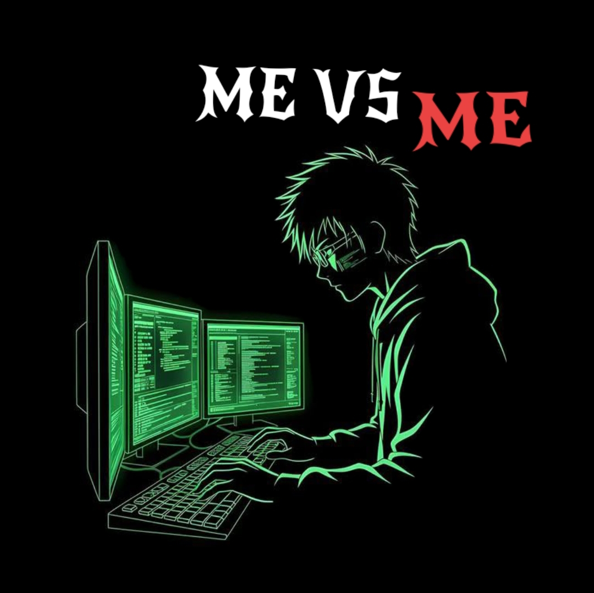

<div align="center">

<!-- ANIMATED HERO TITLE -->
<a href="[https://github.com/Melroy25](https://github.com/Melroy25)">
  
</a>

<!-- ANIMATED TYPING SUBTITLE -->


<br/>

<!-- TOP NAVIGATION & STATUS BADGES -->
<a href="[https://github.com/Melroy25](https://github.com/Melroy25)">
  
</a>
<a href="[https://www.linkedin.com/in/melroyalmeida25](https://www.linkedin.com/in/melroyalmeida25)">
  
</a>
<a href="[https://www.instagram.com/melroy_almeida](https://www.instagram.com/melroy_almeida)_">
  
</a>
<a href="mailto:melroyalmeida6@gmail.com">
  
</a>


</div>

<br/>

<!-- GLOWING ANIMATED DIVIDER -->


## 👨‍💻 About Me

<!-- RIGHT-ALIGNED CIPHER DECODING TERMINAL + IMAGE -->
<table align="right" width="290">
  <tr>
    <td align="center">
      
      <br/>
      
    </td>
  </tr>
</table>

Hey! I'm **Melroy Luvis Almeida**, a **Computer Science Engineering** student passionate about technology, innovation, and engineering products that make an impact.

I thrive on turning ambitious concepts into scalable, real-world applications across AI, Full-Stack Web, Mobile, and Embedded IoT systems.

```yaml
name: "Melroy Luvis Almeida"
role: "Computer Science Engineering Student & Full-Stack / AI Developer"
focus: ["AI & Computer Vision", "Full-Stack Web", "Flutter", "IoT & Cloud"]
mindset: "Me vs Me — Outbuilding yesterday's version of myself."
status: "Open to Hackathons, Collaborations & Exciting Projects"
```

- 🎓 **Education:** Computer Science Engineering Student
- 💻 **Core Focus:** Full-Stack Software & Mobile Application Development
- 🤖 **Intelligence:** Building with Artificial Intelligence, Machine Learning & Computer Vision
- 🔌 **Hardware & Edge:** Experimenting with ESP32, IoT Sensors & Smart Automation
- ☁️ **Infrastructure:** Exploring Cloud Architecture, DevOps & Scalable Backend Systems
- 🏆 **Community:** Active Hackathon Participant & Tech Community Contributor

<br clear="right"/>

<div align="center">
  <table>
    <tr>
      <td align="center">
        <h3>⚡ My Philosophy</h3>
        <i><b>"Never stop experimenting. Every failure is just another version of progress."</b></i>
      </td>
    </tr>
  </table>
</div>


## 🚀 What I'm Exploring

<table width="100%">
  <tr>
    <td width="33%" valign="top">
      <h3 align="center">🌐 Web Architecture</h3>
      <p align="center">
        
        
      </p>
      <p align="center"><sub>Modern React/Next.js frontends paired with scalable Node.js &amp; NestJS backend architectures.</sub></p>
    </td>
    <td width="33%" valign="top">
      <h3 align="center">🤖 AI, ML &amp; Vision</h3>
      <p align="center">
        
        
      </p>
      <p align="center"><sub>Computer Vision pipelines, neural networks, and Generative AI integrations using PyTorch &amp; OpenCV.</sub></p>
    </td>
    <td width="33%" valign="top">
      <h3 align="center">📱 Cross-Platform Apps</h3>
      <p align="center">
        
        
      </p>
      <p align="center"><sub>Fluid, native-performance mobile experiences built with Flutter, Dart, and Kotlin.</sub></p>
    </td>
  </tr>
  <tr>
    <td width="33%" valign="top">
      <h3 align="center">🔌 IoT &amp; Edge</h3>
      <p align="center">
        
        
      </p>
      <p align="center"><sub>Bridging hardware and software through smart microcontroller systems and real-time telemetry.</sub></p>
    </td>
    <td width="33%" valign="top">
      <h3 align="center">☁️ Cloud &amp; BaaS</h3>
      <p align="center">
        
        
      </p>
      <p align="center"><sub>Cloud-native deployments, serverless databases, and instant edge hosting on Vercel &amp; GCP.</sub></p>
    </td>
    <td width="33%" valign="top">
      <h3 align="center">⚙️ Core Engineering</h3>
      <p align="center">
        
        
      </p>
      <p align="center"><sub>Algorithmic problem solving, clean code architecture, and production-grade software design.</sub></p>
    </td>
  </tr>
</table>


## 🛠️ Tech Stack & Tools

### 💻 Programming Languages


### 🌐 Frontend Development


### ⚙️ Backend & Mobile Development


### 🗄️ Databases & Backend Services


### 🤖 AI, ML & Data Science

<p align="left">
  
  
  
  
</p>

### ☁️ Cloud, Deployment & Developer Tools


### 🎨 Design & Creative Tools


## 📊 GitHub Analytics & Activity

<div align="center">

<!-- SUMMARY CARDS (TOKYO NIGHT THEME) -->


<br/><br/>

<!-- STREAK STATS -->


<br/><br/>

<!-- RELIABLE CONTRIBUTION ACTIVITY GRAPH -->


</div>


## 🏆 My GitHub Achievements

<div align="center">

<table width="100%">
  <tr>
    <td align="center" width="50%">
      
      <h3>🦈 Pull Shark</h3>
      <p><i>Merged Pull Requests into open-source &amp; collaborative repositories</i></p>
    </td>
    <td align="center" width="50%">
      
      <h3>🌈 YOLO</h3>
      <p><i>Shipped &amp; merged a Pull Request straight to production</i></p>
    </td>
  </tr>
</table>

**More milestones. More contributions. More achievements to unlock! 🚀**

</div>


## 💬 Developer Quote

<div align="center">


</div>

---

## 🤝 Let's Connect!

<div align="center">

I'm always excited to meet developers, exchange ideas, collaborate on interesting projects, and explore new technologies.

**Got an interesting idea? Let's make it happen!**

<br/>

<a href="[https://github.com/Melroy25](https://github.com/Melroy25)">
  
</a>
<a href="[https://www.linkedin.com/in/melroyalmeida25](https://www.linkedin.com/in/melroyalmeida25)">
  
</a>
<a href="[https://www.instagram.com/melroy_almeida](https://www.instagram.com/melroy_almeida)_">
  
</a>
<a href="mailto:melroyalmeida6@gmail.com">
  
</a>

<br/><br/>


</div>
